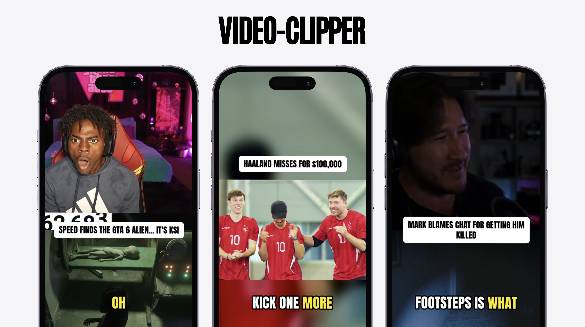

<div align="center">



# VIDEO-CLIPPER

An intelligent video-clipping skill that automates discovery, highlight selection, <br/> editing and post preparation.

**Open source** · Built on [yt-dlp](https://github.com/yt-dlp/yt-dlp), [whisper.cpp](https://github.com/ggml-org/whisper.cpp), [FFmpeg](https://ffmpeg.org) and [OpenCV](https://opencv.org)

[](docs/installation.md)
[](SKILL.md)
[](LICENSE)
[](docs/development.md)

**[Installation](docs/installation.md)** · **[Usage](docs/usage.md)** · **[Commands](docs/commands.md)** · **[Troubleshooting](docs/troubleshooting.md)** · **[Development](docs/development.md)** · **[Issues](https://github.com/aliabbosashurov/video-clipper/issues)**

</div>

## Overview

Video-Clipper is a skill for AI coding assistants and agentic tools. It gives your assistant a complete,
repeatable workflow for turning a long video, as a link or a file, into short vertical clips for TikTok,
YouTube Shorts and Instagram Reels: finding the video, understanding what's in it, choosing the best
moments, cutting, reframing, captioning and writing the post.

It isn't an AI model or a video editor. It orchestrates the assistant's own reasoning together with
proven open-source tools, so one request replaces the whole manual edit.

**What makes Video-Clipper different:**

- **One request, the whole workflow.** Search, transcribe, pick, cut, reframe, caption and write the post
  copy, with no hand-offs between tools.
- **Downloads only what it needs.** Audio first for the transcript, then just the minutes each clip uses.
  The full video is never downloaded.
- **Runs on your machine.** Transcription, face detection and rendering happen locally, and you don't need
  an API key: the picking happens inside your own assistant session.
- **Ready to post.** Every clip comes with a hook title, word-by-word captions placed clear of the platform
  buttons, a cover image, and a title, caption and hashtags.

```
You:     clip this podcast https://www.youtube.com/watch?v=...
Claude:  Done. 3 clips from the 1 h 42 min episode:
           1. "He got fired the day his app went #1"   (00:41:12, 46 s)
           2. "Why your brain cleans itself at night"  (01:05:30, 38 s)
           3. "The investor who said no to Uber"       (01:28:04, 52 s)
         Saved to ~/Video-Clips/.../clips
```

## What you get

For every video, 3 clips (or as many as you ask for), each with:

- **Vertical 9:16 video** (1080×1920), framed automatically: the streamer on top for streams (a webcam box found
  anywhere on screen, or a green-screen cutout followed by a crop), a crop that follows the speaker for
  podcasts, or the full frame for screen recordings
- **A hook title** on screen that makes people stop scrolling
- **Word-by-word captions** that highlight each word as it's spoken, placed where the TikTok, Reels and
  Shorts buttons and description won't cover them
- **Even, platform-ready loudness**
- **A ready-to-paste post**: title, caption and hashtags in a text file next to the clip
- **A cover image** (thumbnail) for each clip

## How it works

1. **Listen.** It downloads only the audio (or reads your file) and transcribes it on your Mac.
2. **Pick.** Claude reads the cleaned-up transcript (silence and music markers removed, in pieces that
   each show how a moment near the end finishes, so none is cut in half) and picks the moments worth sharing: stories, insights, hot takes,
   funny bits and reactions.
3. **Cut.** It downloads only those few minutes of video and renders the clips.

Transcription and rendering run on your Mac. You don't need an API key: the picking happens inside your own
Claude Code session.

## Requirements

- A Mac (Apple Silicon recommended), 8 GB of memory or more
- About 1 GB of free disk space
- [Claude Code](https://claude.com/claude-code)
- [Homebrew](https://brew.sh) is recommended, so setup can install everything for you

See [Installation](docs/installation.md) for full details.

## Installation

**1. Install the plugin.** In Claude Code, run:

```
/plugin marketplace add aliabbosashurov/video-clipper
/plugin install video-clipper@aliabbosashurov
```

**2. Restart Claude Code.**

**3. Say "set up the video clipper".** Claude installs what's missing and downloads the speech model
(~465 MB). For videos that aren't in English, say "set up the video clipper with the multilingual model".

Prefer a plain skill without the plugin system? See [other install options](docs/installation.md#install).

## Usage

Open Claude Code and ask in plain words:

```
clip this video https://www.youtube.com/watch?v=...
make 5 shorts from ~/Movies/episode-12.mp4, it's a startup podcast
turn yesterday's Twitch stream into clips: https://www.twitch.tv/videos/...
find podcast episodes about sleep from this week and clip them
```

Then fine-tune in the same chat:

```
make clip 2 start a bit earlier
give clip 1 a different hook
clip 3 cuts off the speaker, show the full frame instead
make the clips in high quality
```

Quality levels are **fast**, **standard** (the default), **high** (1440p) and **max** (up to 4K). Higher
quality gives a sharper facecam but takes longer. See [Quality](docs/usage.md#quality).

Your clips are saved in `~/Video-Clips/`, and Claude opens the folder when it's done.

More examples and options: [Usage guide](docs/usage.md).

## FAQ

**Do I need an API key or a paid service?**
No. Downloading, transcribing and rendering are free, open-source tools on your Mac. The picking runs on
your existing Claude Code plan.

**Which sites are supported?**
YouTube, Twitch, Kick, Vimeo and the [many other sites yt-dlp supports](https://github.com/yt-dlp/yt-dlp/blob/master/supportedsites.md),
plus any video file on your Mac.

**Will it change my original video?**
No. Local files are only read, never modified, moved or deleted.

**Does it work in other languages?**
Yes. Run setup with `--multilingual`, then tell Claude the language ("clip this Spanish interview").

**Does it run on Windows or Linux?**
Not at the moment. It's macOS only.

Something not working? See [Troubleshooting](docs/troubleshooting.md).

## Documentation

- [Installation](docs/installation.md): requirements, setup options, installing without Homebrew, configuration, updating
- [Usage](docs/usage.md): example requests, editing clips, layouts, quality, output files
- [Command reference](docs/commands.md): every command and option in one place, as tables
- [Troubleshooting](docs/troubleshooting.md): common problems and fixes, known limits
- [Development](docs/development.md): how the code is organised, where a new feature goes, running the tests

## Responsible use

Only clip videos you own or have permission to repost, and watch every clip before you post it.

## License

[MIT](LICENSE). Built on [yt-dlp](https://github.com/yt-dlp/yt-dlp), [whisper.cpp](https://github.com/ggml-org/whisper.cpp),
[FFmpeg](https://ffmpeg.org), [OpenCV](https://opencv.org) and the [Anton](https://fonts.google.com/specimen/Anton) font (SIL Open Font License).
